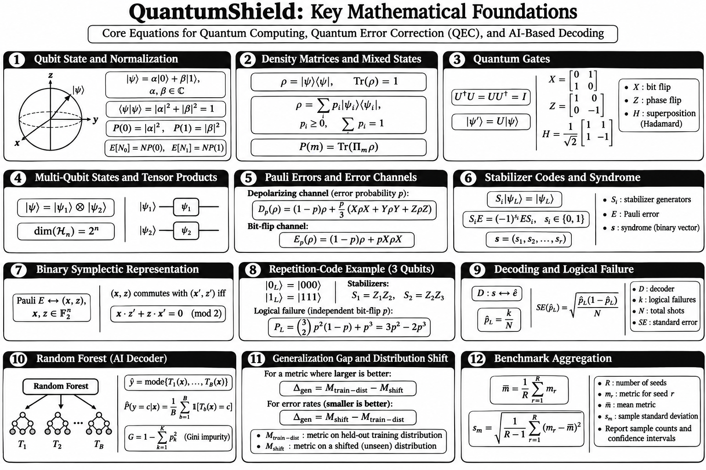

# QuantumShield

> **An open-source, local-first research platform for quantum error correction, AI decoder experimentation, and reproducible benchmarking.**

QuantumShield is a research-oriented software project intended to make quantum error-correction (QEC) experiments easier to run, inspect, compare, and reproduce on ordinary developer computers. The initial research direction is to study whether lightweight machine-learning decoders—starting with **Random Forest**—can generalize to noise conditions not represented in their training data, and to compare them fairly with conventional decoding methods such as minimum-weight perfect matching (MWPM).

**Project status:** Early planning / implementation. The architecture and commands below describe the intended design; they are not claims that every component is implemented today.

---

## Table of contents

- [Research goal](#research-goal)
- [Scope and non-goals](#scope-and-non-goals)
- [Research questions](#research-questions)
- [System architecture](#system-architecture)
- [Core experiment workflow](#core-experiment-workflow)
- [Mathematical foundations](#mathematical-foundations)
- [Decoder strategy](#decoder-strategy)
- [CLI design and checks](#cli-design-and-checks)
- [Technology choices](#technology-choices)
- [Repository layout](#repository-layout)
- [Reproducibility and scientific validity](#reproducibility-and-scientific-validity)
- [Development plan](#development-plan)
- [Team workflow](#team-workflow)
- [Local development](#local-development)
- [Contributing](#contributing)
- [License](#license)

## Package installation

The repository includes an installable Python package using the `src/` layout.
Python 3.10–3.13 are declared in package metadata. The initial runtime package
has no third-party dependencies; development tools are optional.

```bash
python -m venv .venv
# Windows PowerShell: .\.venv\Scripts\Activate.ps1
# Linux/macOS: source .venv/bin/activate
python -m pip install --upgrade pip
python -m pip install -e ".[dev]"
python -m pip check
python -c "import quantumshield; print(quantumshield.__version__)"
python -m pytest
```

See [Installation](docs/installation.md) for complete Windows and Linux
instructions.

The current public Python API exposes `quantumshield.__version__`. A CLI
entry point will be added when real CLI functionality is implemented; no
placeholder command is installed.

## Research goal

Quantum error correction protects logical quantum information by encoding it across multiple physical qubits and extracting error syndromes. A decoder uses the observed syndrome information to choose a recovery operation or infer a logical-frame update.

QuantumShield will provide a coherent local workflow for:

1. Defining and validating QEC experiments.
2. Simulating stabilizer circuits and noise.
3. Generating syndrome and logical-outcome data.
4. Running conventional and machine-learning decoders.
5. Evaluating logical failure rates, uncertainty, runtime, and resource use.
6. Testing generalization under shifted or unseen noise conditions.
7. Saving experiment configurations, seeds, datasets, metrics, and provenance.
8. Inspecting results through a command-line interface (CLI), with a dashboard planned later.

### Primary research question

> How well does a lightweight Random Forest decoder trained on specified noise distributions generalize to previously unseen noise conditions, compared with a conventional decoder, under a controlled and reproducible QEC benchmark?

The work is exploratory. We do **not** assume that Random Forest will outperform a conventional decoder. Negative or inconclusive results are valid research outcomes.

## Scope and non-goals

### Initial scope

- Local CPU execution; no cloud service, API key, paid AI service, cloud GPU, or physical quantum hardware is required.
- Stabilizer-code experiments, beginning with simple educational examples and progressing to Stim-compatible circuits.
- A conventional decoder baseline (PyMatching / MWPM where the chosen detector error model is supported).
- Random Forest as the first ML decoder, using scikit-learn.
- Explicit train/validation/test separation and noise-distribution shift experiments.
- CLI-first workflows and machine-readable outputs.
- Small experiments suitable for a laptop with approximately 16 GB RAM.

### Not initial goals

- Claiming fault tolerance for arbitrary circuits or hardware.
- Replacing established QEC simulators or decoders.
- Guaranteeing ML superiority.
- Requiring a cloud backend or quantum processor.
- Building a large production dashboard before the research pipeline is scientifically validated.
- Treating an exact physical error pattern as a unique target correction when code degeneracy makes multiple recoveries equivalent.

## Research questions

1. **Baseline:** What logical error rate does the conventional decoder achieve for a fixed code, circuit, noise model, and number of shots?
2. **ML performance:** How does a Random Forest compare on exactly the same held-out samples?
3. **Generalization:** How does performance change when test noise differs from training noise (for example, a shifted physical error probability or a different mixture of supported noise channels)?
4. **Resource cost:** What are the training time, inference throughput, and peak memory requirements?
5. **Robustness:** How sensitive are results to code distance, sample count, random seed, and feature representation?

## System architecture

The design is layered. The **research engine is the source of truth**; the CLI, Python API, and future dashboard call the same application services rather than reimplementing scientific logic.

```text
                         QUANTUMSHIELD
                               |
             +-----------------+------------------+
             |                 |                  |
          CLI             Python API        Future Web UI
             |                 |                  |
             +-----------------+------------------+
                               |
                    Application / Use Cases
             (validate, run, train, decode, benchmark,
                     export, inspect experiments)
                               |
             +-----------------+------------------+
             |                 |                  |
        Experiment         Dataset &           Results /
        Configuration      Feature Pipeline    Experiment Store
             |                 |                  |
       Simulation         Syndrome /          JSON, CSV,
       Adapters            Detector Data       SQLite (planned)
             |
       +-----+-----------------------+
       |                             |
   Stim backend                Optional adapters
   (initial focus)             (Qiskit, later)
       |
   Decoder Interface
       |
   +---+---------------------------+
   |                               |
Conventional decoders          ML decoders
PyMatching / MWPM              Random Forest (first)
                               Other models (future)
   |                               |
   +---------------+---------------+
                   |
           Evaluation & Benchmarking
       logical failures, uncertainty, runtime,
          memory, generalization, provenance
                   |
            Reports / Visualizations
```

### Layer responsibilities

| Layer | Responsibility | Initial implementation |
|---|---|---|
| CLI | Parse commands, validate options, present readable output and exit codes | Typer or argparse (choose during implementation) |
| Application services | Coordinate use cases without embedding simulator-specific code in the CLI | Python modules |
| Configuration | Typed experiment definitions, defaults, validation, schema version | dataclasses or Pydantic |
| Simulation adapter | Construct circuits, run shots, expose detector/sampler outputs | Stim |
| Syndrome/data pipeline | Generate, validate, split, and persist features and targets | NumPy; documented dataset schema |
| Decoder interface | Common fit/decode/evaluate contract | Python protocol or abstract base class |
| Conventional decoder | Baseline decoding from a supported detector error model | PyMatching |
| ML decoder | Train and infer using syndrome-derived features | scikit-learn RandomForestClassifier |
| Benchmarking | Metrics, confidence intervals, timing, resource tracking | NumPy/SciPy and standard timing tools |
| Experiment store | Store configuration, seeds, software versions, metrics, and artifact paths | JSON/CSV initially; SQLite later |
| Dashboard | Explore experiments and plots | FastAPI + React, only after CLI pipeline works |

### Data flow

1. A user supplies a versioned experiment configuration.
2. The application validates the configuration and records its resolved form.
3. The simulation adapter builds a circuit and samples detector events / observables.
4. The dataset layer builds documented features and targets without leaking test information into training.
5. A decoder is trained (for ML) or configured (for a conventional baseline).
6. The evaluator applies the decoder to held-out data and computes logical performance and resource metrics.
7. The experiment store records the seed, configuration, versions, model metadata, metrics, and artifact locations.
8. CLI commands inspect, compare, and export those records.

## Core experiment workflow

A first meaningful benchmark should be small and end-to-end:

1. Implement and understand the three-qubit repetition code as a teaching example.
2. Introduce a stabilizer-circuit workflow using Stim.
3. Define one supported noise model and document exactly where noise is applied.
4. Generate detector events / syndromes and observable outcomes with fixed seeds.
5. Establish the conventional decoder baseline where the circuit and detector error model are supported.
6. Define a mathematically valid Random Forest target and feature map.
7. Train only on the training split.
8. Evaluate both decoders on the same held-out test samples.
9. Repeat across seeds and noise settings; report statistical uncertainty.
10. Test a clearly specified distribution shift.

**Important label design:** for QEC, the target should represent a valid recovery decision or logical-frame outcome under the selected code and decoder formulation. Do not naively train a classifier to reproduce one sampled physical error pattern: distinct physical errors can have the same syndrome and may be logically equivalent. Document degeneracy, target construction, and how logical failures are counted.

## Mathematical foundations

The equations below summarize the mathematical tools used throughout QuantumShield. The poster provides a compact visual reference; the explanations underneath describe **why each concept matters** to the simulator, decoder, or benchmark.



### 1. Qubit state and normalization

A qubit is represented by two complex amplitudes, and normalization ensures that its measurement probabilities add up to one.

**Why it is used:** This is the basic mathematical representation of quantum information. It explains the possible measurement outcomes of a qubit and provides a foundation for understanding quantum states before introducing error correction.

### 2. Density matrices and mixed states

A density matrix represents a quantum state when it may be pure or a statistical mixture of possible states. Its trace is one, and measurement probabilities are obtained using the Born rule.

**Why it is used:** Quantum noise can turn an initially pure state into a mixed state. Density matrices provide the language for describing noisy quantum systems and the effect of quantum error channels.

### 3. Quantum gates

Quantum gates are unitary transformations. The Pauli gates describe bit and phase changes, while the Hadamard gate creates or removes superposition.

**Why it is used:** Gates define how quantum circuits operate. QuantumShield relies on circuit-level operations to describe the computation, inject noise, and study how errors affect measured outcomes.

### 4. Multi-qubit states and tensor products

The tensor product combines individual qubit state spaces into a joint multi-qubit state space. An (n)-qubit state has dimension (2^n).

**Why it is used:** Quantum error-correcting codes store logical information across multiple physical qubits. Tensor products describe these joint systems and explain why general-purpose state-vector simulation becomes expensive as the number of qubits grows.

### 5. Pauli errors and error channels

Pauli errors model bit flips, phase flips, and combinations of these errors. A quantum channel describes how noise changes a state, with the parameter (p) controlling the error probability under the stated convention.

**Why it is used:** Noise is the central condition that a QEC decoder must handle. QuantumShield uses explicit noise models to generate experiments and to test whether a decoder still works when the noise conditions change.

### 6. Stabilizer codes and syndrome

Stabilizer generators define the code space. A syndrome records whether an error commutes or anticommutes with each stabilizer measurement.

**Why it is used:** The syndrome is the information used by a decoder to infer an appropriate recovery. It connects the simulated measurements to the decoding task. In circuit-level experiments, detector events may combine measurement outcomes across rounds, so their definition must be documented separately.

### 7. Binary symplectic representation

An (n)-qubit Pauli operator can be represented using binary (X)- and (Z)-component vectors. The symplectic condition determines whether two Pauli operators commute.

**Why it is used:** This representation makes stabilizer calculations easier to store, validate, and compute. It can support code checks and algebraic tests without manipulating large quantum-state vectors.

### 8. Repetition-code example

The three-qubit bit-flip repetition code encodes logical zero and one into three physical qubits. Majority voting corrects one bit flip, and the displayed logical-failure expression gives the idealized failure probability for independent bit-flip noise.

**Why it is used:** This small code is an understandable starting point for implementing and testing the complete QEC workflow. Its analytical failure probability is also a useful reference for checking simulator and decoder results. It protects against bit flips, not arbitrary bit and phase errors simultaneously.

### 9. Decoding and logical failure

A decoder maps a syndrome or detector-event record to a recovery decision. The estimated logical failure rate is the number of failed shots divided by the total number of shots.

**Why it is used:** This defines the main outcome QuantumShield measures. A recovery should be judged by whether it corrects the logical information, not simply by whether it reproduces the exact physical error pattern. For rare failures, confidence intervals should be reported rather than interpreting zero observed failures as a true zero rate.

### 10. Random Forest (AI decoder)

A Random Forest combines predictions from multiple decision trees. The poster also shows the class-vote probability and Gini impurity used when growing classification trees.

**Why it is used:** Random Forest is QuantumShield's first machine-learning decoder candidate. It provides a CPU-friendly baseline for testing whether a model can learn useful relationships between syndrome features and recovery or logical-frame decisions. Training labels must account for stabilizer degeneracy and must not simply assume that every physical error has one unique correct label.

### 11. Generalization gap and distribution shift

The generalization gap compares a decoder's performance on held-out data from the training distribution with its performance on a declared shifted distribution. The sign convention depends on whether the metric is one where larger or smaller values are better.

**Why it is used:** This is the core research question of QuantumShield. It measures how much decoder performance changes when test noise differs from training noise, such as training at one physical error probability and evaluating at another. The shifted test set must not be used for model selection.

### 12. Benchmark aggregation

The mean and sample standard deviation summarize a metric across repeated independent random seeds. Sample counts and confidence intervals provide additional information about uncertainty.

**Why it is used:** A result from one random seed may be misleading. Repeated runs help quantify variability and make comparisons between Random Forest and conventional decoders more reliable and reproducible. Decoders should be compared on equivalent test instances wherever possible.


## Decoder strategy

### First decoder: Random Forest

- Library: scikit-learn.
- Runs locally on CPU.
- First ML model for a clear, inspectable baseline.
- Input features: documented syndrome/detector-event representation.
- Target: code- and experiment-specific recovery/logical-frame label with degeneracy handled explicitly.
- Persist model parameters, training-data identity, feature schema, seed, and library version.
- Evaluate only on held-out data; do not tune using the final test set.

### Conventional baseline: PyMatching

PyMatching provides a matching-based decoder for supported detector error models. Its compatibility and assumptions must be checked for each experiment. It is a baseline, not a claim of universal optimality.

### Future extension points

The decoder interface should allow future models (for example, a small neural network or graph-based decoder) without changing the simulator or experiment format. These are future extensions, not initial commitments.

## CLI design and checks

QuantumShield is **CLI-first**. Proposed commands below define the desired user experience; they should only be advertised as available after implementation.

```bash
# Basic information and health
quantumshield --version
quantumshield doctor
quantumshield config validate experiment.yaml

# Discover available components
quantumshield list experiments
quantumshield list decoders

# Run simulation and data generation
quantumshield simulate run experiment.yaml
quantumshield dataset generate experiment.yaml

# Train and evaluate the first ML decoder
quantumshield ai train --model random-forest --config experiment.yaml
quantumshield ai evaluate --model random-forest --config experiment.yaml

# Compare against a conventional decoder
quantumshield benchmark compare --decoders random-forest,pymatching

# Inspect and export records
quantumshield experiment list
quantumshield experiment show <experiment-id>
quantumshield results export <experiment-id> --format csv

# Project quality checks
quantumshield validate
quantumshield test
```

### Required CLI behaviour

- Consistent help text and examples for every command.
- Validate configuration and arguments before starting expensive simulations.
- Clear progress and actionable error messages.
- Stable, documented exit codes; non-zero for failed validation or execution.
- Machine-readable JSON output for automation, in addition to human-readable terminal output.
- No secrets or API keys required.
- Optional dependencies must be reported clearly rather than causing unrelated commands to crash.
- Record command options and resolved configuration in experiment provenance.

### CLI diagnostic checklist

| Check | Expected behaviour |
|---|---|
| Python/runtime | Detect supported Python version |
| Dependencies | Identify missing required packages and optional extras |
| Configuration | Validate types, ranges, and incompatible settings |
| Simulator | Run a tiny smoke circuit and verify sample shape |
| Noise | Check parameter bounds and documented channel convention |
| Syndrome/detectors | Validate dimensions, values, and detector/observable alignment |
| Dataset | Check shape, dtype, labels, leakage, and split metadata |
| Decoder | Check interface, fit/predict contract, and output dimensions |
| Random Forest | Verify deterministic behavior for fixed seed and saved-model round trip |
| Baseline decoder | Verify compatible detector model and valid output |
| Benchmark | Check metric calculations on known synthetic examples |
| Reproducibility | Re-run a small experiment from saved configuration and seed |
| Storage/export | Verify JSON/CSV round trip and artifact paths |
| Integration | Execute a minimal end-to-end experiment |
| Test suite | Run unit, integration, and CLI tests |

## Technology choices

| Purpose | Initial choice | Rationale |
|---|---|---|
| Language | Python | Research ecosystem and team familiarity |
| Stabilizer simulation | Stim | Efficient stabilizer-circuit simulation and detector sampling |
| Conventional matching decoder | PyMatching | Established matching-based QEC baseline |
| Data and numerical work | NumPy | Arrays and numerical operations |
| First ML decoder | scikit-learn RandomForestClassifier | CPU-friendly, interpretable baseline |
| Experiment statistics | SciPy / Python standard library | Statistical analysis |
| CLI | Typer or argparse | Typed command interface or standard-library option |
| Tests | pytest | Unit and integration tests |
| Initial storage | JSON and CSV | Transparent, portable experiment artifacts |
| Structured local store | SQLite (planned) | Queryable local experiment registry |
| Future API/UI | FastAPI and React (planned) | Separate presentation layer after CLI maturity |

Pin and record dependency versions in reproducible environments. Exact compatible versions will be selected and tested during setup rather than guessed in this planning document.

## Repository layout

The layout will evolve as modules are implemented; avoid creating empty placeholder packages solely to make the tree look complete.

```text
QuantumShield/
├── README.md
├── LICENSE
├── CONTRIBUTING.md
├── CODE_OF_CONDUCT.md
├── pyproject.toml
├── .gitignore
├── .github/
│   ├── ISSUE_TEMPLATE/
│   └── pull_request_template.md
├── src/
│   └── quantumshield/
│       ├── cli/
│       ├── config/
│       ├── application/
│       ├── simulation/
│       │   └── stim_backend/
│       ├── qec/
│       │   ├── codes/
│       │   ├── noise/
│       │   └── syndromes/
│       ├── decoders/
│       │   ├── base.py
│       │   ├── pymatching/
│       │   └── random_forest/
│       ├── datasets/
│       ├── evaluation/
│       └── storage/
├── tests/
│   ├── unit/
│   ├── integration/
│   └── cli/
├── experiments/
│   ├── configs/
│   └── README.md
├── examples/
└── docs/
    ├── architecture/
    ├── mathematics/
    ├── research/
    └── decisions/
```

## Reproducibility and scientific validity

Every experiment should preserve, at minimum:

- Unique experiment ID and creation timestamp (UTC).
- Versioned, resolved configuration.
- Simulator, decoder, and dependency versions.
- Random seeds and number of shots.
- Code family, distance, rounds, and circuit/noise specification.
- Feature schema and label-generation method.
- Dataset split strategy and distribution definition.
- Decoder hyperparameters and model artifact reference.
- Logical failures, logical error rate, sample count, and confidence interval.
- Training time, inference time, and resource measurements where available.
- Warnings, unsupported features, and execution environment.

Scientific safeguards:

1. Compare decoders on equivalent circuits, noise assumptions, and test samples.
2. Separate train, validation, and test sets; never tune on the final test set.
3. Document all noise parameter conventions.
4. Account for stabilizer degeneracy and logical equivalence in target construction.
5. Report uncertainty and sample counts, especially for rare logical failures.
6. Record failed and incomplete runs; do not silently discard inconvenient results.
7. Avoid claiming that a model generalizes beyond the specific tested shifts.
8. Treat results as experimental evidence, not a proof of decoder optimality.

## Development plan

Milestones should be outcome-based, not calendar promises. With two contributors working around one hour each per day, parallel work helps, but research and validation tasks may take multiple weeks.

| Milestone | Outcome |
|---|---|
| M0 — Foundation | Repository conventions, Python package, CLI skeleton, CI, diagnostic command |
| M1 — Quantum foundations | Verified math notes and small unit-tested state/gate examples |
| M2 — First QEC example | Three-qubit repetition-code simulation and analytic probability test |
| M3 — Stim pipeline | Small stabilizer circuit, detector events, observable outcomes, smoke tests |
| M4 — Noise and datasets | Versioned noise configuration, reproducible dataset generation, data validation |
| M5 — Conventional baseline | Supported PyMatching path and logical-failure evaluation |
| M6 — Random Forest | Documented feature/target construction, training, persistence, inference |
| M7 — Generalization study | Controlled train/test noise shifts and repeated-seed metrics |
| M8 — Experiment management | Provenance, local storage, comparison, CSV/JSON export |
| M9 — Visualization and release | Useful plots, documentation, contribution workflow, validated alpha release |
| M10 — Future UI | API and dashboard only after the underlying research workflow is stable |

## Team workflow

For a two-person team:

- **Research / QEC track:** quantum concepts, code definitions, Stim circuits, noise, syndrome semantics, decoder design, and scientific analysis.
- **Platform / engineering track:** package structure, CLI, configuration, testing automation, storage, reporting, and later dashboard integration.
- Both contributors review interfaces, tests, data semantics, and benchmark claims.
- Agree on decoder and dataset interfaces before parallel implementation.
- Use short-lived feature branches and pull requests.
- Link each pull request to its issue and include test evidence.
- Keep only a small number of issues actively in progress; the rest remain planned backlog items.

## Local development

See [docs/installation.md](docs/installation.md) for complete, platform-specific package installation steps.

```bash
git clone https://github.com/nischalk987/QuantumShield.git
cd QuantumShield

# Create and activate a virtual environment (example: Windows PowerShell)
python -m venv .venv
.\.venv\Scripts\Activate.ps1

# Linux / macOS activation
# source .venv/bin/activate

# Install the project after pyproject.toml is available
python -m pip install --upgrade pip
python -m pip install -e ".[dev]"

# Run checks once implemented
pytest
quantumshield doctor
quantumshield --help
```

These commands are a target developer workflow; package installation and CLI commands become valid when the corresponding project files and entry points are implemented.

## Contributing

Contributions are welcome, especially:

- Reproducible QEC experiment configurations.
- Better documented noise models and decoder adapters.
- Tests for syndrome and logical-observable semantics.
- Independent replication of benchmark results.
- CLI usability, documentation, and visualization improvements.

Before opening a pull request:

1. Link the relevant issue.
2. Explain the scientific or engineering rationale.
3. Add or update tests.
4. Include CLI output or benchmark evidence where relevant.
5. Document assumptions, limitations, and reproducibility details.
6. Do not commit generated large datasets, private credentials, or machine-specific files.

## License

QuantumShield is released under the **Apache License 2.0**. See [LICENSE](LICENSE).

---

*QuantumShield is an evolving open-source research project. Features, benchmarks, and research conclusions will be marked as implemented only after code, tests, and reproducible evidence are available.*
